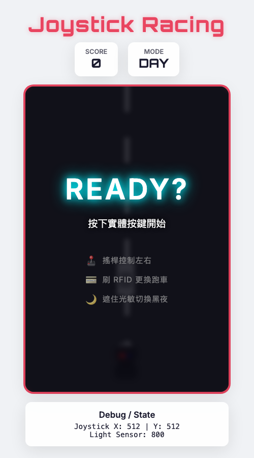
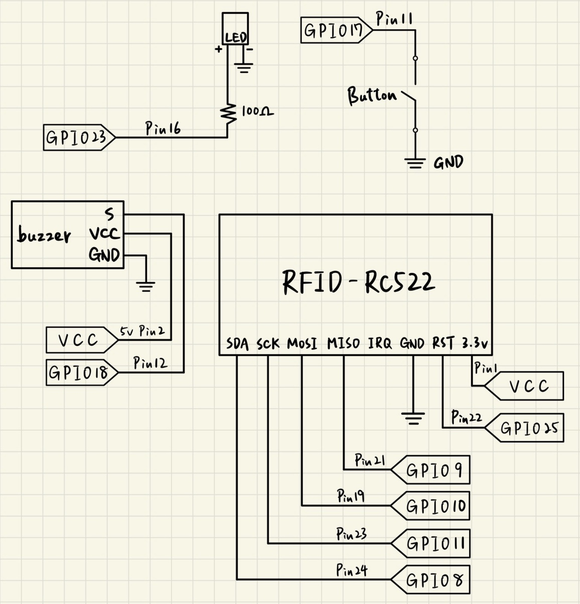
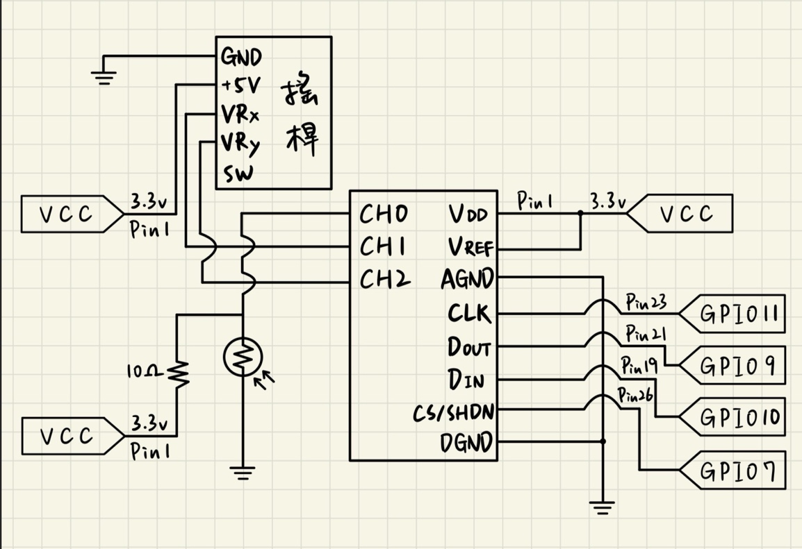

# Raspberry Pi 搖桿賽車

碩士班嵌入式系統課程的期末專案。在 Raspberry Pi 上整合搖桿、光敏電阻、RFID、按鈕、
蜂鳴器與 LED，以 Flask 作為硬體與網頁之間的橋樑，讓實體裝置即時操控網頁上的賽車遊戲。

- **搖桿**：左右移動賽車，也用來選擇 VIP 跑車顏色
- **按鈕**：開始遊戲、確認選擇
- **光敏電阻**：遮住感測器即切換為夜間模式
- **RFID**：刷卡解鎖 VIP 跑車
- **蜂鳴器與 LED**：得分音效、被追捕時的警笛與閃燈、遊戲結束音效

示範影片：https://youtu.be/H1b39Be00Vo



## 系統架構

```
硬體 ──► hardware.py（背景執行緒，每 0.05 秒讀取）──► hardware_state
                                                        │
                                       GET /api/state ◄─┘  （JSON）
瀏覽器 game.js ── 每 50 ms 輪詢 ─────────────────────────┘
        │
        └── POST /api/feedback（得分 / 撞車 / 警笛）──► hardware.py ──► 蜂鳴器、LED
```

- **硬體讀取與網頁分離**：感測器讀取放在獨立的背景執行緒，Flask 只回傳最新狀態，
  網頁請求不會因為等待硬體而卡住。警笛音效也在另一條執行緒中執行，不影響讀取頻率。
- **兩支 API**：`GET /api/state` 回傳搖桿、光敏電阻、按鈕與 RFID 狀態；
  `POST /api/feedback` 接收遊戲事件，觸發蜂鳴器與 LED。
- **夜間模式鎖定**：光敏數值低於門檻時切換為夜間模式並保持，玩家不需要一直遮住感測器；
  該局結束 1.5 秒後才恢復白天。
- **模擬模式**：找不到 Raspberry Pi 的硬體套件時自動改用預設值，在一般電腦上也能開啟網頁。

## 硬體與接線

| 元件 | 連接方式 |
|---|---|
| 類比搖桿（X / Y） | MCP3008 CH1 / CH2 |
| 光敏電阻（與 10Ω 電阻分壓） | MCP3008 CH0 |
| MCP3008 ADC | SPI，CE1（Pin 26） |
| RFID RC522 | SPI，CE0（Pin 24），RST 接 Pin 22 |
| 按鈕 | Pin 11，內部上拉 |
| LED | Pin 16，串接 100Ω 電阻 |
| 蜂鳴器 | Pin 12，PWM |

腳位一律使用實體 Pin 編號（`GPIO.BOARD`）。MCP3008 改用 CE1，避免與 RFID 共用 CE0。

 

## 執行

```bash
pip install -r requirements.txt
python app.py
```

開啟 `http://<Raspberry Pi 的 IP>:5001`，同一個網路下的電腦或手機都能連線。
在一般電腦上執行時會進入模擬模式，只安裝 `flask` 即可。

## 目錄

```
app.py               Flask 伺服器與 API
hardware.py          GPIO / SPI 讀取、背景執行緒、蜂鳴器與 LED 控制
static/game.js       Canvas 遊戲邏輯、硬體狀態輪詢
static/style.css     介面與日夜模式樣式
templates/index.html 遊戲頁面
docs/                接線圖與截圖
```
